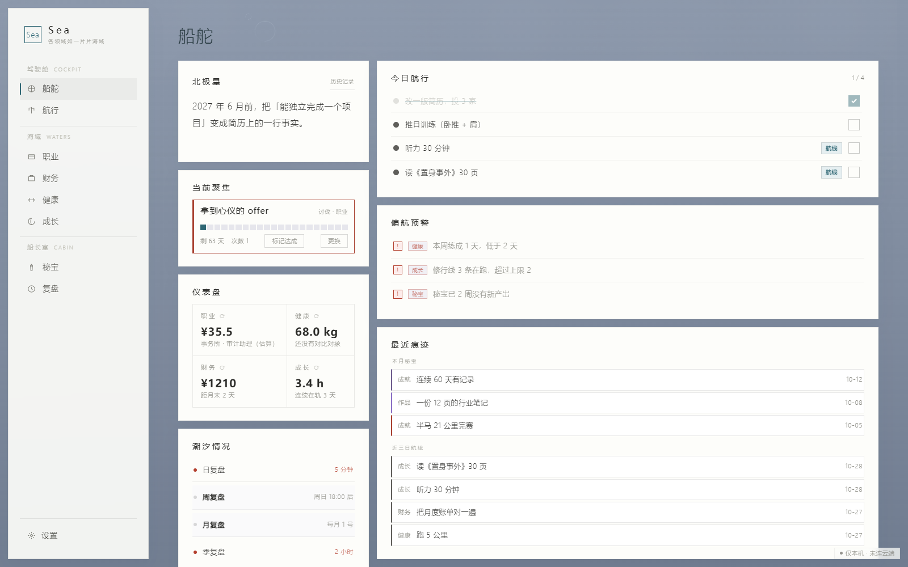
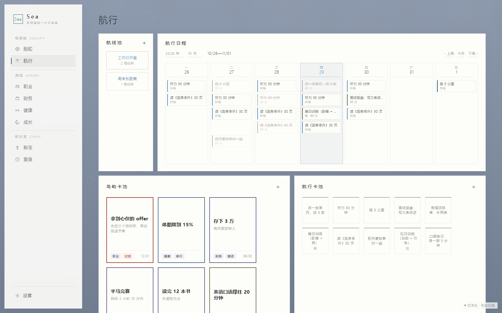
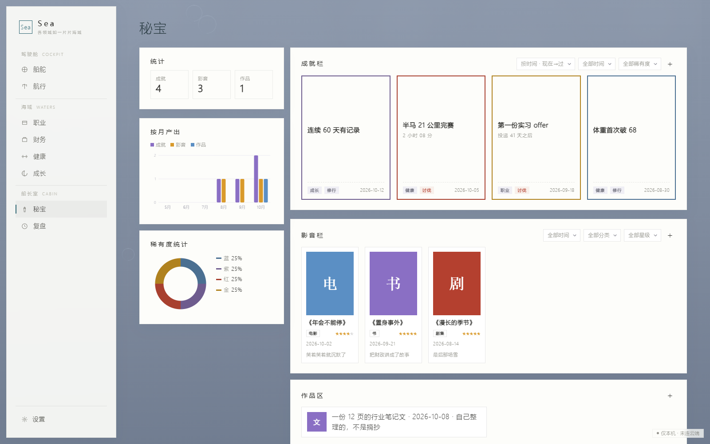
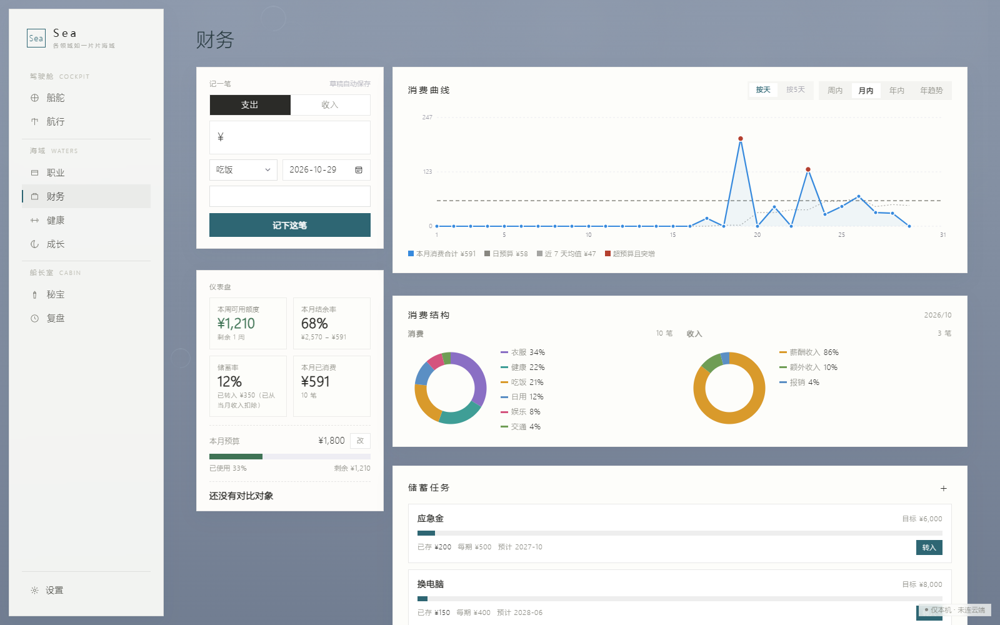

# Sea-life-board

**一个 HTML 文件，就是完整的个人工作台。** 八个页面——船舵、航行、秘宝、职业、财务、健康、成长、复盘。零依赖、无构建、无账号，数据默认只存在你自己的浏览器里。

`MIT` · `v2.10.0` · `598KB 单文件` · `无 CDN / 无 npm 依赖` · `纯本地存储`

**[在线试用](https://mason-yu-28.github.io/sea-life-board/)** ｜ **[下载单文件](Sea-2.8.html)** ｜ **[使用说明](docs/GUIDE.md)** ｜ **[截图](#八个页面)**

---

## 先搞清三种东西

界面上所有操作，都是在这三种东西之间搬来搬去。搞混它们是最常见的困惑来源：

| 界面叫 | 是什么 | 之后会怎样 |
|---|---|---|
| **岛屿卡** | **目标**。有名字、有海域、有截止日 | 达成后变成就卡进「秘宝」，**原卡不消失**（要留着算兑现率） |
| **航行卡** | **这周要做的一件事**，通常 15–60 分钟 | 排进日历才有「完成」。卡池里的卡没有完成态 |
| **航线** | **重复安排的模板**（每周三练腿） | 铺到日历上，每次生成的那几张可以单独改、单独删 |

岛屿卡还分三种类型：**讨伐**（有死线，必须做完）、**修行**（没有终点，长期重复）、**铸造**（有明确产出物）。选哪个不影响功能，影响的是你怎么理解它。

---

## 八个页面

### 船舵 · 首屏

每天只开这一页就够了。七个区块，从上到下：**北极星**（一句话写清一年后的取舍标准，随时能改，历史版本留着）→ **当前聚焦**（只显示一张卡，就是你现在真正在推的那个）→ **仪表盘**（五个海域各一个主数字）→ **潮汐情况** → **今日航行**（今天排的卡，能直接勾）→ **偏航预警** → **最近痕迹**。

它不催你，只告诉你哪里在偏。



### 航行 · 核心页

上下两块：**航线池（左侧固定窄栏）+ 周历**，下面是**岛屿卡池 + 航行卡池**。

周视图，周一到周日，**每天 10 格**。顶部能选年选月，点周标签弹出月历总览直接跳。卡池支持按住空白处横向拖动翻页。

**拖拽就是排期，语义按你拖的是什么决定：**

| 拖什么 | 拖到哪 | 结果 |
|---|---|---|
| 航行卡 | 某一格 | 排进那天的那个位置 |
| 岛屿卡 | 日期列（整列） | 给这一天设「目标岛屿」标记（一天只允许一张） |
| 专线航线 | 日期列 | 排入这一天，**可以拖多天**；再拖一次已排的那天 = 取消 |
| 环线航线 | 任意一列 | 按它设定的星期，整周铺一遍 |
| 航线弹窗里的日程卡 | 别的格 | 两格对调 |
| 同上 + 按住 `Alt` | 别的格 | **复制**，源格保留 |

**五套右键菜单**，按你点在哪决定：日期列（清空这一天 / 管理目标岛屿标记）、空的日程格（新建并排入 / 从卡池选一张）、日程上的卡（完成 / 修改 / 取消这次安排）、岛屿卡（编辑 / 达成 / 删除）、航线卡（编辑 / 清除排期 / 删除）。

> 注意两个「删除」不是一回事：日程上「取消这次安排」是把卡放回卡池，卡还在；卡池里「删除」才是真的删掉。



### 秘宝 · 只陈列不删除

左边一列统计（成就 / 影音 / 作品三个计数、按月产出、稀有度分布），右边三层陈列：

- **成就栏** —— 五个海域的成就卡汇总在这里
- **影音栏** —— 书 / 电影 / 剧集 / 番剧 / 纪录片 / 游戏 / 音乐。字段是封面（点击或拖入，自动压缩）、条目名、载体、观看时间、**评星 1–5**、一句话短评
- **作品区** —— 自己的产出：文 / 图 / 视 / 数

点任意一张卡，进 **3D 展柜**，拖动可以转视角。红卡和金卡会冒光。

**成就卡的金卡可以自己设，但必须上传凭证**（图片压到最长边 1400px，非图片 ≤1MB）。没有凭证的金卡存不进去——自封的金卡没有证据，就只是一张好看的边框。



### 职业 · 唯一一个有「永驻档案层」的页面

**薪资推演**是本页最耐用的功能。填八个参数，它算两个数字：

```
真实时薪 = (到手月薪 × 发薪月数 ÷ 12 − 每月工作成本)
          ÷ ((在场时间 + 通勤 + 加班) × 每月工作日)
```

四个容易填错、填错就高估的地方：月薪用**税后**、减掉**为上班花的钱**、在场时间**含午休**、每月工作日**自己填**（别套 21.75）。右侧三个滑块（通勤变化 / 加班变化 / 涨薪幅度）是**假设推演**，不写进记录，用来比较哪个 offer 更值。

**档案**部分：基本档案 + 多个角色，每个角色下有简历 / 项目 / 成就三栏。这里是只增不改的长期库——旧履历不要删，删了就算不出兑现率。

### 财务 · 数据从账单里来，不从手感里来

**本周可用额度 = 本月剩余预算 ÷ 本月剩余周数。** 这是唯一该天天看的数字。旁边还有本月结余率、储蓄率、本月已消费。

**导入账单**：粘贴微信账单 CSV 文本，或上传 `.csv` / `.txt`（自动识别 UTF-8 / GBK）。它先出预览——识别到几笔、自动归类几笔、多少笔进未分类、有没有和已有流水重复，**确认后才真正写入**。

归不进已知类别的不会瞎猜，统一进**待分类队列**，你在那里一张张指派。**分类映射表是这个页面唯一越用越值钱的东西**：每指派一次，下次同类商户就自动归好。流水可以单独导成 Excel。



### 健康

记身体指标：身高 / 体重 / 体脂 / 上臂围 / 腰围 / 臀围 + 日期。仪表盘给本周训练 X / Y 天、体重、BMI、腰臂比和趋势。

**训练数据不在这里单独记。** 它读的就是航行里的训练卡（带「推 / 拉 / 腿 / 其他」部位的航行卡，或健康海域的卡）——所以在航行里排一次、勾掉，这里的热力图就亮了。页面上的「+ 新增训练」只是个快捷方式，建的仍是一张航行卡。

### 成长

**记一笔投入**：日期 / 时长（分钟）/ 内容 / 目标岛屿。但更常见的用法是**不手记**——成长海域的航行卡勾完成后自动入账。

仪表盘：本周投入时长、连续在轨天数、探索进度、未分类条数。「待归类投入」是没挂目标岛屿的那些，指派给某张岛才算进它的探索进度。

### 复盘 · 四个节奏，四套问题

| 档 | 时长 | 问什么 |
|---|---|---|
| **日** | 5 分钟 | 今天有卡落地吗 / 有要补回的吗 / 明天第一件事 |
| **周** | 30 分钟 | 哪些卡动了、哪些一次没动 / 有卡抛锚吗 / 下周哪几件占格子 / 财务额度够吗 |
| **月** | 1 小时 | **这个月我产出了什么** / 四域数字哪些在动 / 结余率储蓄率 / 围度重测了吗 |
| **季** | 2 小时 | 主线域要不要换 / 哪些卡该关 / 履历体检 / 哪个部件从没用过，删掉它 |

每一档上面都有**自动摘要**：先把你这个周期的活动事实摆出来（完成了几张卡、投入多久、花了多少），你看着数据回答，不是凭空回忆。

月度那一问是全系统最狠的一句——**列不出来，说明这个月只有输入没有输出。**

---

## 勾掉一张卡，四个地方同时变

这是这套东西真正的价值所在，也是它不像待办清单的地方：

1. **成长**的投入流水自动多一条（不用手记）
2. **健康**的热力图上那个部位亮一格（训练卡）
3. 那张**岛屿卡**的「最后活动日」被刷新——这是**抛锚检测**唯一的数据来源
4. **船舵**的今日航行、仪表盘、偏航预警跟着重算（连续 4 周没活动的卡会被点名）

一张卡只勾一次，四处留痕。所以卡池里没有「完成」按钮——卡还没排进时间，勾了也没有痕迹可留。

---

## 三步开始

```bash
# 1. 下载 Sea-2.8.html（Code → Download ZIP，或点开文件 → Download raw）
#    或者什么都不下载，直接在线试用

# 2. 双击打开。或起本地服务（推荐，localStorage 行为更接近真实环境）：
python -m http.server 8080
# 访问 http://localhost:8080/Sea-2.8.html

# 3. 进「航行」→ 岛屿卡池 → ＋，立第一个目标
```

**第一次打开是一张空白盘**，没有任何示例数据——每个空区域都有「还没有 X · 点哪里做 Y」的提示。空盘是正常状态，不是坏了。

**建议头 10 分钟只跑一个最小闭环**：写北极星 → 立一张岛屿卡 → 记一张航行卡 → 拖到日历 → 双击打勾 → 右键岛屿卡「标记达成」→ 回秘宝看它出现。跑完这一圈，剩下七个页面都是这套东西的不同视角。完整步骤见 [`docs/GUIDE.md`](docs/GUIDE.md) 第 4 节。

> **在线试用和本地打开是两个独立的世界。** 浏览器的存储绑在域名上，`mason-yu-28.github.io` 和你双击打开的文件是两个不同的存储空间。线上试完再下载，数据不会跟过去。想长期用就下载。

---

## 它和待办 / 笔记类工具的区别

一句话：**它们问「今天做什么」，它问「这一年偏到哪了」。**

时间尺度是年 → 月 → 周三层都能回看；目标、任务、日历在结构里就连着，不用靠标签手动关联；做完的东西不消失，流进秘宝攒着。代价是启动慢——**要接受「先配半小时，之后每天记两分钟」**。

不适合：要多人协作的（没有账号体系）、主要用手机记事的（只做了窄屏断点，拖拽和右键在触屏上很别扭）、要跨设备自动同步的（没有服务端，就没有同步可依赖）、只想记待办的（用 Todoist 更省事）。

---

## 数据存在哪

**默认不生成任何文件**，全部写进浏览器 `localStorage`（按站点隔离）。想让数据同时落成一个看得见的文件：**设置 → 存档文件 → 绑定**，选一个 `sea-存档.json`，之后每次改动 1.2 秒内自动整份写入。

| 位置 | 存什么 |
|---|---|
| `sea_workspace_v1` | 主数据（目标、卡、流水、统计），约 10KB。**唯一真源** |
| `sea_assets_v1` | 附件（封面、简历、凭证），base64 |
| `sea_snap_*` | 每次启动前的本机快照，出事能捞一把 |
| IndexedDB `sea_file_db` | 只存你绑定文件的**句柄**，不存数据 |
| 你绑定的 `sea-存档.json` | 可选。实时副本，与「导出备份」同格式，可直接导入 |

**两句话记住：**

1. **清浏览器数据 = 那份没了**，没有服务端兜底。绑过文件的话重新绑定就接回来了。
2. **最省事的保险**：存档文件放网盘同步目录，绑上，之后不用管。没绑就定期「设置 → 导出备份」。

存档文件用的是 File System Access API，只有 Chromium 系有；Firefox 和手机上自动退化成「只有浏览器存储」，其余功能一点不减。

---

## 已知局限

- **只在 Chromium 系验证过**（Chrome / Edge）。Safari 的 `localStorage` 配额与 iframe 策略不同，未测
- **移动端只有窄屏断点**，没有独立的触屏交互设计
- **交互路径靠人工点检**。`tests/` 里有五个自动化脚本（空白首启、数据口径、存档文件、XSS、外观像素），拖拽和右键菜单还没有
- **单用户、单设备假设**。同一个浏览器给两个人用会互相覆盖
- **文件名还叫 `Sea-2.8.html`，实际已是 v2.10.0**。早期就叫 2.8，后来觉得改名的收益抵不上重发一次的风险。真实版本看页面「设置」

## 为什么是单文件

因为它要能在任何地方打开：宿舍电脑、图书馆公用机、手机浏览器、一个 U 盘、十年后某个已经不存在的系统。

代价也明确：这是一个 1 万行的文件，**没有模块系统**，改动的影响面靠纪律而不是编译器。所以仓库里有 `docs/audit/` 那三份体检底稿——`AUDIT-01-代码地图.md` 就是为了回答「一万行里这一行归谁」。取舍的完整讨论在 [`docs/DESIGN.md`](docs/DESIGN.md)。

## 目录

```
Sea-2.8.html          主文件，1 万行，全部代码在这里
index.html            Pages 入口，跳转到主文件
LICENSE               MIT
CHANGELOG.md          版本史，含每次事故的根因复盘
docs/
  GUIDE.md            使用说明（零基础可读，从打开写到复盘）
  DESIGN.md           设计取舍：数据模型、存储分层、为什么单文件
  GITHUB-PLAYBOOK.md  发布手册：发版 5 步 + 出问题对照表
  HOSTING.md          多个版本的关系与同步纪律
  PUBLISH.md          发布前该传什么、不该传什么
  REPO-TEXT.md        仓库文案：About / Topics / Release
  assets/             README 用的截图（虚构数据）
  audit/              体检底稿：代码地图 / 文档偏差 / 缺陷清单
scripts/              export-public · sync-check · release · shots
tests/                回归脚本，npm test 一条跑完
```

## 需要什么帮助

- **用起来觉得别扭的地方直接提 issue**，说清当时想干什么、卡在哪一步——这类反馈比功能请求有用
- **布局问题请带截图和浏览器版本**，窄屏和触屏的问题需要这两样才能复现
- 取舍很明确（单文件、无账号、无云），**不符合这三条的改动基本不会接受**，其余都可以谈

## 许可

MIT。拿去改、拿去用、拿去卖都行，保留版权声明即可。

## 关于

一个人做的。2026 年 10 月开始，迭代了 30 多个版本，中间丢过两次数据，两次都写进了 `CHANGELOG.md`。

做它的原因：市面上的待办工具都在问「你今天要做什么」，而我想找一个会问「你这个月偏航了吗」的东西。
