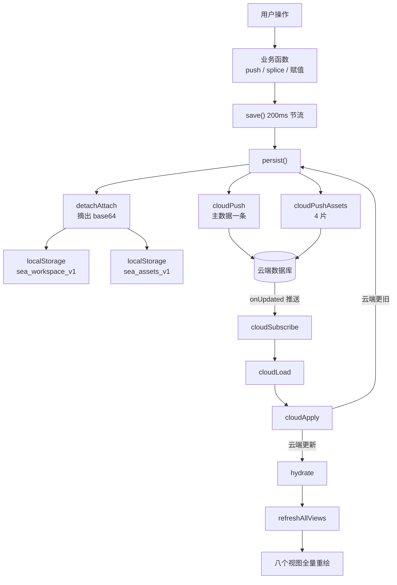

# AUDIT-01 · 代码地图

> 对象：`Sea-2.8.html` · 10272 行 / 606KB
> 目的：让任何人（或任何 AI）在 20 分钟内知道"这个文件里东西都在哪、谁调谁"。
> 所有行号基于 v2.8（2026-10-22）。

## 一、文件分区

| 行号 | 内容 | 占比 |
|---|---|---|
| 1–8 | `<head>`：meta、标题、版本注释（`SEA_CHANGES` 之前的那段人类可读变更摘要） | 忽略 |
| **9–2582** | **全部 CSS**，单 `<style>`，未压缩 | 25% |
| 2583–3429 | 全部 HTML 结构：侧栏、八个视图容器、弹窗骨架 | 8% |
| **3430–10182** | **主逻辑**，单 `<script>`，全局作用域，无模块化 | 66% |
| 10186–10270 | 海面动画，IIFE 隔离，唯一有命名空间边界的一段 | 1% |

三个数字值得记住：**349 个函数、130 处 `addEventListener`、198 处 `innerHTML`**。这是判断"改动影响面"的量级。

## 二、CSS 分区（9–2582）

不是按组件组织的，是**按时间叠加**的——后写的规则压前面的。所以读样式要从后往前看。

| 行号 | 区块 | 说明 |
|---|---|---|
| 337–452 | 船舵 | 首屏驾驶台布局 |
| 422 / 836 / 1024 | 职业域（三代） | 同一块写了三次，后者覆盖前者 |
| 453 / 692 / 703 / 725 | 财务 / 健康 / 成长 / 目标条状卡 | 四域共用一套骨架，靠 class 区分 |
| 1130–1410 | 海图台主题（主体） | 大部分视觉在这里 |
| 1411–1447 | 数据管理弹窗 | |
| 1448–1837 | 海图台主题 v20（回填） | 大幅覆盖 1130 段 |
| 1838 / 1866 | 航行卡去色 / 稀有度独占色 | 颜色语义的唯一权威 |
| 1915 / 1927 / 1939 / 1952 / 1970 | 拖拽手感 / 日程 / 卡片起点 / 运维四键 / 全局直角 | 五次小改的补丁层 |
| 2037–2290 | 多段 `====` 分隔的覆盖层 | 每段一个决策，注释里有日期 |
| 2291–2382 | 移动端 `≤900px` | **唯一**的响应式断点 |
| 2383–2581 | v2.1 全局直角 | 最后一层，压掉所有圆角 |

**读法**：想看某个组件长什么样，别在第一个匹配处停下——往下翻，后面八成还有覆盖。这也是"残留 CSS"最容易藏身的地方。

## 三、HTML 结构（2583–3429）

一个 `.ocean`（海面背景层）+ 一个 `.sidebar`（导航）+ 八个视图容器（`#view-cockpit` / `#view-calendar` / `#view-treasure` / `#view-career` / `#view-finance` / `#view-health` / `#view-growth` / `#view-review`）+ 一组 `.modal-mask`。

导航切换只做 `display` 切换，**八个视图永远同时存在于 DOM**。所以任何一次全量渲染都会同时动八块——这是 `refreshAllViews()` 存在的理由，也是性能开销的来源。

## 四、主逻辑分层（3430–10182）

虽然写在一个作用域里，但实际有清晰的三层。改动前必须先判断"我要改的是哪一层"。

### 第 1 层 · 状态层（3430–3568）

所有业务数据是**顶层 `let` 变量**，共 40 余个：

```
islands  sails  achieves  collects  works  routes  occMoves  occGone  occDone
resumes  projects  pays  cvVersions  events  firms  thresholds  wageRecords  careerAchieves  myParams
exps  incs  catMap  budgets  finBudget  finWhite  pendingTxns  savings  finDraft  ...
bodies  hlthHeight  hlthDraft  grwDraft  grows  materials  reviews  northStar  northStarHistory
dashMode  achSort  achTime  achRarity  focusIslandId  blankStart  finFilter  finChartMode ...
```

三个非显而易见的点：

1. **这些变量不在 `window` 上**（`let` 不挂全局对象）。所以恢复存档只能靠 `eval('变量名 = d.变量名')`（3694 行）。这是刻意为之的——用 `window[k]=d[k]` 写过一版，结果刷新后数据根本没恢复，注释里记了这件事。**别"优化"掉 `eval`**，除非同时改成"状态装进一个对象"。
2. **`occ*` 三个映射是航线派生卡的"当次状态"**：`occMoves`（挪期）、`occGone`（这一天删了）、`occDone`（勾完成）。key 形如 `rtId|2026-10-21|0`。它们**不回写航线本身**，这是产品决策：改一次当次，不动模板。
3. **`STATE_KEYS` + `STATE_DEFAULTS`（3555–3562）**是"整份换状态"的实现基础。新增任何持久化变量，**三处都要加**：变量声明、`STATE_KEYS`、`hydrate` 的 keys 数组。漏一处就会出现"清空后它还在"或"刷新后它没恢复"。这是本项目最容易踩的坑，`hydrate` 里的 keys 和 `STATE_KEYS` 目前是两份手工维护的重复列表，很容易不同步。

### 第 2 层 · 持久化层（3569–4060）

这是全文件最复杂、也最容易出事故的部分。调用关系：

```
任何业务改动
   └─ save()                      4057  200ms 节流
        └─ persist()              3618  唯一落盘入口
             ├─ buildData()       3610  收集 40+ 变量成一个对象
             ├─ detachAttach()    3791  把 base64 附件摘出来（内存里立刻填回）
             ├─ localStorage.setItem 主数据 + 附件两个 key
             ├─ cloudPush()       3865  → flushCloud() 3951
             └─ cloudPushAssets() 3874  → pushAssetChunks() 3880  按 600KB 分 4 片

启动
   ├─ snapshotLocal()             3660  先把本机存档复制一份快照（只拍一次）
   ├─ loadStore()                 3671  读 localStorage → hydrate()
   └─ cloudLoad()                 3982  异步拉云端 → cloudApply() 4001
                                          ├─ 内容相同 → 认出回声，什么都不做
                                          ├─ 云端更旧 → 反推本机（自愈）
                                          └─ 云端更新 → hydrate() + 覆盖本地

「整份换状态」的三个动作（清空 / 载入示例 / 导入）
   └─ _resetting=true → resetMemory() → loadStore()/seedDemo() → afterStateChange()
      _resetting 期间 persist() 直接 return，防止定时器把旧数据写回去
```

**三个必须理解的保护机制**：

| 机制 | 位置 | 防的是什么 |
|---|---|---|
| `_resetting` 闸门 | 3619 | 清空/导入过程中，3 秒定时器把旧数据又写回存档 |
| `_cloudHold` | 3846 | 新设备首次打开时，还没拉到云端就先往云端推示例数据，把真数据盖掉 |
| `_cloudLastJson` 内容判等 | 3836 | 写云端触发 `onUpdated` 回声，误判成"别人改了"，每点一下弹一次提示 |

**`_lastDataJson` / `_lastAssetJson`（3617、3841）**是落盘指纹，内容没变就不重复写。注意它们和 `_cloudLastJson` 不是一回事：前两个是"本机上次写的"，第三个是"云端已知的那份"。混淆它们会造成重复推送或漏推。

### 第 3 层 · 渲染层（4061–10182）

按域切分，每个域一个 `renderXxx()` 主入口：

| 行号 | 模块 | 主入口 |
|---|---|---|
| 4061–4374 | 示例数据（种子） | `seedDemo` / `seedFinance` / `seedFinPrevMonth` |
| 4375–4403 | 导航 | `showView` |
| 4404–4751 | 日历 / 周视图 / 月概览 | `renderCalendar` / `renderMonthOverview` |
| 4752–4909 | 三个卡池（岛屿 / 航行 / 航线） | `renderIslandPool` / `renderSailPool` / `renderRoutePool` |
| 4910–5170 | 右键菜单（五套） | `ctxOpenAt` / `openSlotCtx` / `openOccCtx` / `openIslandEditCtx` / `openRouteCtx` |
| 5171–5582 | 弹窗体系 | `openModal` / `openIslandModal` / `openSailModal` / `openRouteModal` |
| 5583–6145 | 秘宝（成就 / 影音 / 作品 / 检视） | `renderTreasure` / `openInspect` / `renderMediaInspect` |
| 6146–6660 | 船舵（首屏） | `renderCockpit` |
| 6661–7583 | 职业域 | `renderCareer` / `renderTrendChart` |
| 7584–8800 | 财务域 | `renderFinance` / `renderTrendChart`(消费曲线) / `parseBillText` |
| 8800–9295 | 健康域 + 训练口径 | `renderHealth` / `entriesOn` / `trainWeekDays` |
| 9296–9585 | 成长域 | `renderGrowth` |
| 9586–9663 | 复盘（潮汐） | `renderReview` |
| 9664–10182 | 数据管理（导出/导入/清空/示例）+ 全局事件绑定 | `applyImported` / `openDataClear` / `bindDomainButtons` |

**`refreshAllViews()`（3570）**会依次调用全部八个渲染入口，并用 `try/catch` 逐个包住——某个域渲染炸了不影响其他域，但错误只进 `console.warn`，**界面上看不出来**。这是"某个页面莫名空白"的第一个排查点。

## 五、数据流（一张图）



## 六、五个刻意的设计取舍（不是缺陷，别"修"）

1. **单文件、零依赖**。分发形态就是"一个 HTML 拷到哪都能跑"。拆模块会毁掉它。
2. **`eval` 写回词法绑定**。因为状态是 `let` 顶层变量，不在 `window` 上。改成对象化是一次大重构，不是顺手改。
3. **附件与主数据分离（v2.8）**。起因是"整份 JSON 一条记录"超过云端上限，图一多就把主数据一起拖死。剥离/填回是在序列化边界上做的，渲染代码一行没改——这个设计是对的，改动时务必保持"内存里始终完整"。
4. **八个视图同时挂在 DOM**。为了切换零延迟，代价是每次全量重绘要动八块。要优化只能改架构，不是改某个函数。
5. **颜色只给稀有度**。海域一律灰（3438 行注释：用户裁决）。别给海域加色。

## 七、要动手前的阅读顺序

改存档相关 → 先读 3569–4060 一整段（约 500 行），别跳。
改某域渲染 → 先看 `refreshAllViews` 有没有包含它，再看这个域有没有 `renderXxx` 之外的旁路更新（有的模块直接改 `innerHTML` 不走主入口）。
改样式 → 从 2582 往回读，别从 9 开始。
新增持久化字段 → 变量声明、`STATE_KEYS`、`buildData`、`hydrate` 的 keys、`resetMemory` 的覆盖范围，五处对齐。

## 八、已知的重复与冗余（清理建议，不是 bug）

- `hydrate` 的 keys（3687–3691）与 `STATE_KEYS`（3555–3560）几乎完全相同，两份手工列表，容易漏。建议合并成一个常量。
- `buildData`（3610）里同样的 40 多个字段又列了一遍，是第三份。
- 三份列表合一，是本项目性价比最高的重构之一：不改变任何行为，但消除一类"新增字段忘了加"的 bug。
